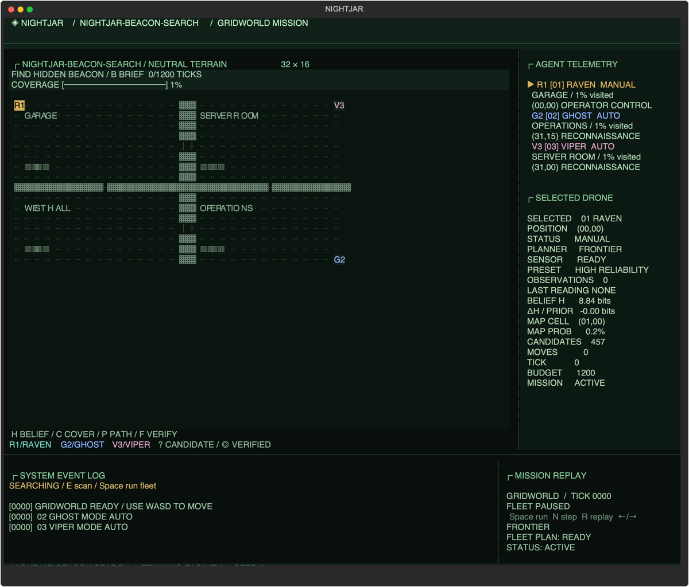

# Nightjar

I’ve been a little too into Rainbow Six Siege lately, and its recon drones got me
thinking about how a small team might search a building together. Nightjar is my
local, terminal-based take on that idea: a fictional facility, a few virtual
drones, and a shared map for gathering intel.

In the demo, **R1, G2, and V3 are the drones**: R1 (RAVEN) is the one you pilot;
G2 (GHOST) and V3 (VIPER) search other rooms on their own. Their movement and
synthetic scan readings build a picture of the facility and narrow down where the
hidden beacon might be.



It’s a small experiment in surveillance-style recon and intel gathering, not a
real-world surveillance tool. The facility, beacon, and sensors are simulated. A
positive reading is a clue, not a confirmed discovery; target confirmation isn’t
modeled yet.

## Try the mission

Requires Python 3.11 or newer. From the repository root:

```bash
python3.12 -m venv .venv
.venv/bin/python -m pip install -e .
.venv/bin/python -m nightjar
```

Use any installed Python 3.11+ executable; change `python3.12` if needed.

<details>
<summary>Windows PowerShell</summary>

```powershell
py -3.12 -m venv .venv
.\.venv\Scripts\python.exe -m pip install -e .
.\.venv\Scripts\python.exe -m nightjar
```

</details>

In the setup screen, choose **Training Facility**, **Standard**, **3 drones**,
**Manual**, **Frontier**, **High reliability**, and **seed 6**. Use a full-size
terminal for the complete map and mission panels.

`WASD` moves your drone · `E` scans · `N` advances the fleet · `Space` runs or
pauses it · `R` replays the mission · `B` opens the brief.

For the exact walkthrough and screenshots, see the [demo guide](docs/DEMO.md).

## What it shows

- One drone stays under your control while the other two search independently.
- Scans update the team’s shared picture of where the beacon might be.
- Replay shows where the drones went and which readings they collected.

## More if you’re curious

The deeper implementation notes live separately:

- [Architecture and simulation boundaries](docs/ARCHITECTURE.md)
- [Search policies, metrics, and measured comparisons](docs/BENCHMARKS.md)
- [Design decisions](docs/DESIGN.md)
- [Roadmap and known limitations](docs/ROADMAP.md)
- [Development setup and tests](docs/WORKFLOW.md)
