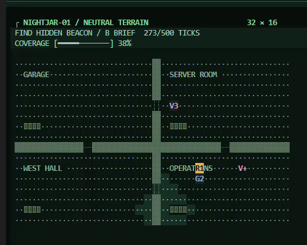
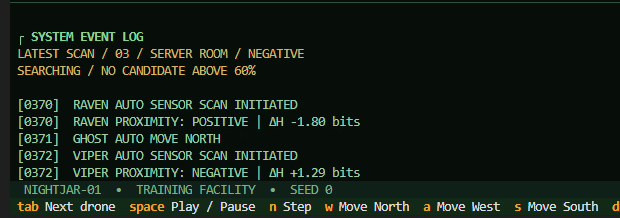

# Nightjar

Nightjar is a local terminal simulation inspired by the recon drones in Rainbow
Six Siege. Virtual drones explore a fictional facility and share scan readings
as they search for a hidden beacon.

## Watch the search

The clip joins Raven, Ghost, and Viper mid-mission as they search the Training
Facility in AUTO mode.

[](docs/demo/media/beacon-search.mp4)

[Watch the full recording (MP4)](docs/demo/media/beacon-search.mp4)

**1. Follow the fleet.** R1, G2, and V3 mark the three drones on the map. The
coverage bar shows how much of the facility they’ve visited.



**2. Spot a lead.** Raven logs a positive proximity scan near the Server Room.
The fleet keeps searching. Confirming the beacon requires a separate check.



## Try the mission

Requires Python 3.11 or newer. From the repository root:

```bash
python3.12 -m venv .venv
.venv/bin/python -m pip install -e .
.venv/bin/python -m nightjar
```

Use any installed Python 3.11+ executable; change `python3.12` if needed.

<details>
<summary>Windows PowerShell</summary>

```powershell
py -3.12 -m venv .venv
.\.venv\Scripts\python.exe -m pip install -e .
.\.venv\Scripts\python.exe -m nightjar
```

</details>

For a hands-on mission, choose **Training Facility**, **Standard**, **3 drones**,
**Manual**, **Frontier**, **High reliability**, and **seed 6**. This setup
lets you pilot Raven while Ghost and Viper search on their own.

`WASD` moves your drone · `E` scans · `F` verifies a candidate · `N` advances the
fleet · `Space` runs or pauses it · `R` replays the mission · `B` opens the brief.

For the manual beacon verification walkthrough, see the [demo guide](docs/DEMO.md).

## More if you’re curious

The deeper implementation notes live separately:

- [Architecture and simulation boundaries](docs/ARCHITECTURE.md)
- [Search policies, metrics, and measured comparisons](docs/BENCHMARKS.md)
- [Design decisions](docs/DESIGN.md)
- [Roadmap and known limitations](docs/ROADMAP.md)
- [Development setup and tests](docs/WORKFLOW.md)
