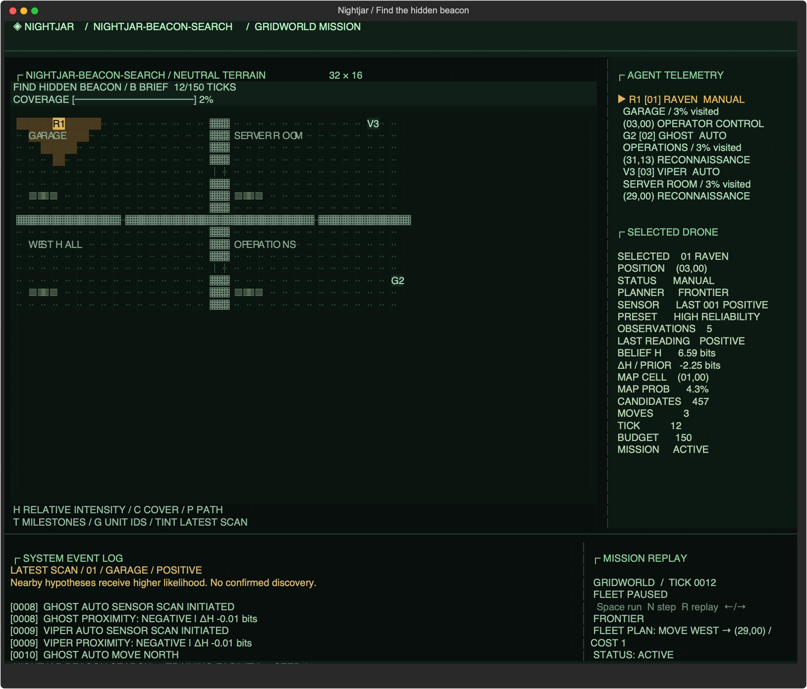

# Beacon search demo

The walkthrough is a small, repeatable mission: pilot one drone through the
Training Facility, let the other two search, and use a scan to update the shared
evidence map.

The captures use the real Textual UI at **132 columns × 55 rows**, so the map,
drone telemetry, event log, and replay timeline all fit without scrolling. Maximize
your terminal for a similar view.

## Launch and configure

From the repository root, run:

```bash
.venv/bin/python -m nightjar
```

Use these settings in mission configuration:

| Setting | Value |
| --- | --- |
| Operation name | `NIGHTJAR BEACON SEARCH` |
| Environment | Training Facility |
| Map | Standard (32 × 16) |
| Drones | 3 |
| Initial control | Manual |
| Search policy | Frontier |
| Sensor | High reliability |
| Tick budget | 150 |
| Seed | 6 |

Review the preflight screen and launch.

## Play the walkthrough

1. Press `D` three times to move R1 through the Garage.
2. Press `N` four times. Each step lets the two autonomous drones search while R1
   remains under manual control.
3. Press `E` to scan from R1's position. With these settings, the deterministic
   run produces a positive synthetic reading and updates the shared evidence map.
4. Press `R` to review the recorded mission. Use the arrow keys to seek; press `R`
   again to return to the live mission.

The positive reading is a clue, not proof that the beacon was found. This version
does not model target confirmation, real aircraft, or physical sensors.

## Captures




The animated capture at the top of the [project README](../README.md) follows the
same seed and interaction sequence.

## 40-second video storyboard

- **0–5s:** “One hidden beacon. Three drones.” Show the facility and mission goal.
- **5–13s:** Pilot R1 through the Garage; keep G2 and V3 visible as teammates.
- **13–21s:** Step the autonomous fleet through the connected rooms.
- **21–29s:** Scan. Show the positive reading and the map update; caption it “A clue,
  not proof.”
- **29–36s:** Enter replay and seek one recorded action.
- **36–42s:** Close on “A local search simulation. Discovery confirmation is not
  modeled.”

## Deeper engineering

For the implementation behind the walkthrough, see [architecture](ARCHITECTURE.md),
[measured search-policy comparisons](BENCHMARKS.md), and [known limitations](ROADMAP.md).
