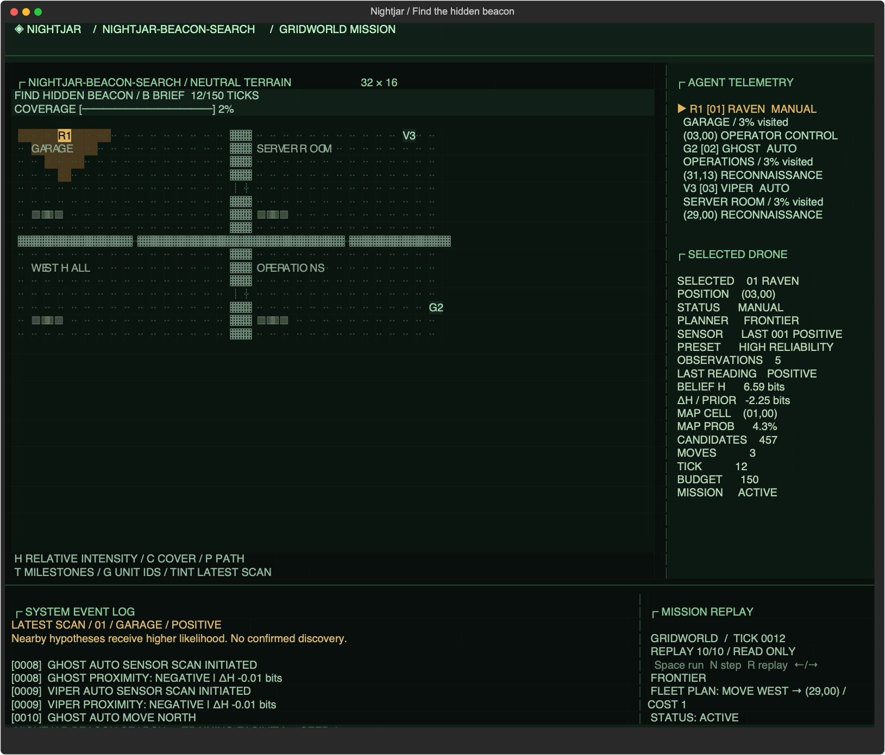

# Beacon search demo

I’ve been playing a lot of Rainbow Six Siege lately, and the recon drones gave me
the idea for this little search sim. The demo is a fictional intel-gathering
mission, not a recreation of the game or its maps.

R1 (RAVEN), G2 (GHOST), and V3 (VIPER) are the three virtual drones. You pilot R1
through the Garage; G2 and V3 search other rooms and add synthetic readings to the
shared map. The goal is to narrow down where the hidden beacon might be.

The captures use the real Textual UI at **132 columns × 55 rows**, so the map,
drone telemetry, event log, and replay timeline all fit without scrolling. Maximize
your terminal for a similar view.

## Launch and configure

From the repository root, run:

```bash
.venv/bin/python -m nightjar
```

Use these settings in mission configuration:

| Setting | Value |
| --- | --- |
| Operation name | `NIGHTJAR BEACON SEARCH` |
| Environment | Training Facility |
| Map | Standard (32 × 16) |
| Drones | 3 |
| Initial control | Manual |
| Search policy | Frontier |
| Sensor | High reliability |
| Tick budget | 150 |
| Seed | 6 |

Review the preflight screen and launch.

## Play the walkthrough

1. Press `D` three times to move R1 through the Garage.
2. Press `N` four times. Each step lets the two autonomous drones search while R1
   remains under manual control.
3. Press `E` to scan from R1's position. With these settings, the deterministic
   run produces a positive synthetic reading and updates the shared evidence map.
4. Press `R` to review the recorded mission. Use the arrow keys to seek; press `R`
   again to return to the live mission.

The positive reading is a clue, not proof that the beacon was found. This version
does not model target confirmation, real aircraft, or physical sensors.

## Captures




The animated capture at the top of the [project README](../README.md) follows the
same seed and interaction sequence.

## 40-second video storyboard

- **0–5s:** Introduce the beacon-search simulation and show the facility.
- **5–13s:** Label R1/RAVEN as pilot-controlled; G2/GHOST and V3/VIPER search
  autonomously.
- **13–21s:** Move R1 through the Garage while the other two gather readings.
- **21–29s:** Show the positive synthetic scan and the shared-map update. Make clear
  it is a clue, not confirmation.
- **29–36s:** Replay the run to show where the drones went.
- **36–42s:** Close with the note that the scenario and sensors are simulated.

## Deeper engineering

For the implementation behind the walkthrough, see [architecture](ARCHITECTURE.md),
[measured search-policy comparisons](BENCHMARKS.md), and [known limitations](ROADMAP.md).
